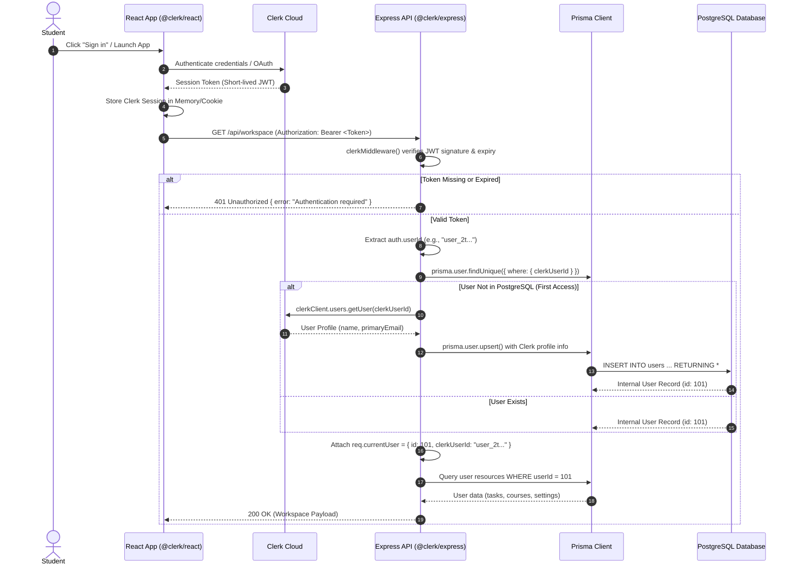
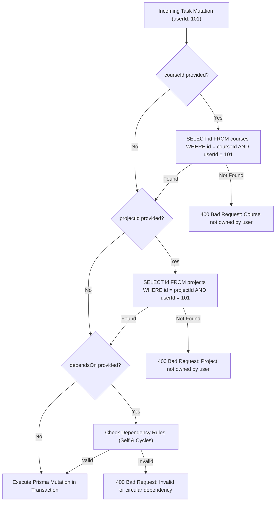
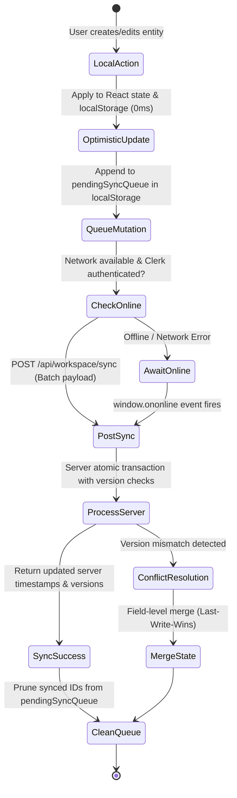
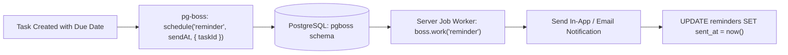
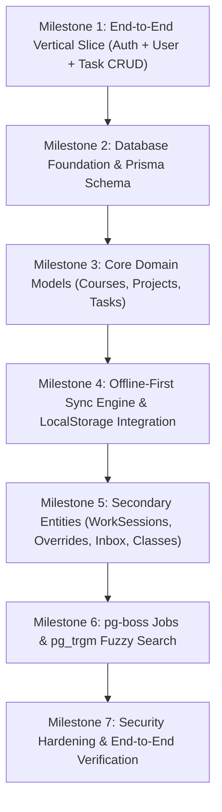
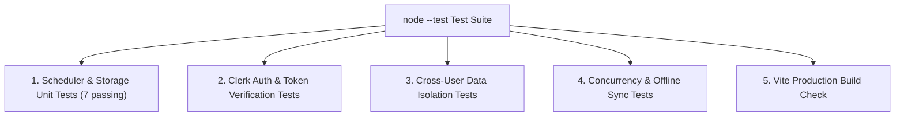

# Crunchless: Finalized Database & Backend Implementation Plan

> **Document Type:** Production Architecture Blueprint & Implementation Roadmap  
> **Status:** Finalized for Engineering Review  
> **Target Codebase:** Crunchless (React 19 + Vite + Express 5 + PostgreSQL + Prisma ORM + Clerk Auth)  
> **Version:** 3.0 (Reconciled with Clerk Auth, Prisma, pg-boss, and Offline-First LocalStorage)

---

## 1. Executive Summary

Crunchless is an intelligent, local-first academic workload forecasting application that helps students anticipate study crunches before they hit. The application is currently implemented as a client-centric React application with full Clerk authentication on the frontend, in-browser `localStorage` persistence, and a stateless Express calculation server.

This document establishes the **finalized, implementation-ready blueprint** to transition Crunchless into a robust, cloud-synchronized full-stack system powered by **PostgreSQL**, **Prisma ORM**, **Express 5**, and **Clerk**.

### Core Reconciliations & Decisions
1. **Clerk as Sole Identity Authority:** Custom password hashing, manual JWT token issuance, refresh-token rotation, and the `refresh_tokens` table from the original PRD are eliminated. Clerk handles user registration, session management, and authentication tokens exclusively.
2. **Dual-ID User Mapping:** The PostgreSQL database maintains an internal, auto-incrementing integer identifier (`User.id`) for high-performance relational foreign keys, paired with Clerk's global string identifier (`User.clerkUserId`) for external identity anchoring.
3. **Just-In-Time (JIT) User Provisioning:** First-time authenticated requests to the backend atomically provision or retrieve the internal `User` record via Prisma `upsert()`, pulling profile data directly from Clerk without storing credentials.
4. **Preserved String Entity Identifiers:** Domain entities (`Task`, `Course`, `Project`, `WorkSession`, `AvailabilityOverride`, `InboxItem`) utilize client-friendly `cuid()` string identifiers (`String @id @default(cuid())`), perfectly matching the current `localStorage` architecture and enabling offline client-side entity creation without ID translation collisions.
5. **Decoupled Deterministic Scheduler:** The core scheduling algorithm in `src/lib/scheduler.js` remains a pure, deterministic function with zero dependencies on Express, Prisma, or PostgreSQL, preserving 100% test pass rates and instant client-side responsiveness.
6. **Robust Offline-First Synchronization:** The client maintains an optimistic `localStorage` cache for 0ms UI latency, coupled with a server-authoritative incremental sync engine utilizing entity versioning, tombstones for deletions, and atomic transactions.
7. **PostgreSQL Extensions & Background Queues:** Leverages `pg_trgm` for fuzzy task title matching during smart imports and `pg-boss` for background job orchestration (deadline reminders and automated re-planning) without introducing Redis.

---

## 2. Existing Architecture Assessment

### 2.1 Codebase Inspection Findings

An exhaustive audit of the existing codebase (`package.json`, `src/App.jsx`, `src/lib/storage.js`, `src/lib/scheduler.js`, `server/index.js`, `.env`) revealed the current system capabilities and architectural discrepancies:

| Module / Area | Current Codebase State | Assessment & Requirements |
|---|---|---|
| **Node.js & Express** | Node `>=22.12.0`, Express `^5.1.0` (ES modules) | Express 5 automatically catches rejected promises in async middleware. `server/index.js` currently does not load `.env`, causing Clerk middleware to throw if Node is run without `--env-file=.env`. |
| **Authentication** | `@clerk/react` `^6.18.5` in frontend; `@clerk/express` `^2.1.87` in backend | Frontend uses `useUser()` and Clerk components (`<UserButton>`, `<SignInButton>`). Backend mounts `clerkMiddleware()`, but has no route handlers extracting `getAuth(req)`. |
| **Persistence** | LocalStorage only via `src/lib/storage.js` | Scoped by `crunchless-project-v24_${userId}` with fallback to `crunchless-project-v24`. Uses string IDs like `"c-net"`, `"t-1"`, or `randomId("task")`. No database connectivity is established. |
| **Driver & ORM** | `"pg": "^8.16.3"` in `package.json` | `pg` is installed but never imported or initialized. Prisma is not yet installed. |
| **Scheduler Engine** | Pure function in `src/lib/scheduler.js` | Exports `buildSchedule` and `getTaskEstimate`. Pure, deterministic, completely isolated from DOM and network. Tested by 7 passing native Node unit tests (`npm test`). |
| **Entity Models** | 10 distinct entities in `storage.js` | Supports `profile`, `availability`, `overrides`, `settings`, `courses`, `projects`, `tasks`, `inbox`, `workSessions`, and `classes`. |

### 2.2 Discrepancies Between PRD and Codebase

1. **Entity Identifier Formats:** PRD Section 9.3 specified `SERIAL` (integer) IDs for tasks and courses. The codebase relies on string IDs (`c-net`, `randomId()`). Using integer IDs in PostgreSQL would break all existing `localStorage` data upon synchronization. **Resolution:** Use `String @id @default(cuid())` in Prisma.
2. **Missing `projects` Table in PRD:** PRD 9.3 defined tasks with courses, but omitted projects. The codebase features a first-class `projects` collection (`ProjectsPage`, project dialog, task `projectId`). **Resolution:** Add `Project` model in Prisma schema.
3. **Work Session Field Naming:** PRD 9.3 specified `duration_minutes`; frontend objects use `minutes`. **Resolution:** Schema uses `durationMinutes Int? @map("duration_minutes")` with API translation handling both.
4. **Custom Auth vs Clerk:** PRD F1 and 9.3 specified email/password registration, bcrypt/argon2 hashing, and a `refresh_tokens` table. **Resolution:** Fully superseded by Clerk.

---

## 3. Finalized Technology Stack

| Layer | Selected Technology | Version / Specification | Justification |
|---|---|---|---|
| **Frontend Framework** | React + Vite (JavaScript) | React 19.3, Vite 8.3 | Existing codebase standard; zero TypeScript overhead; blazing-fast HMR. |
| **Auth Provider (Client)** | `@clerk/react` | `^6.18.5` | Production-ready auth modals, session tokens, user profile metadata. |
| **Backend Runtime** | Node.js (ES Modules) | `>=22.12.0` | Native `--env-file` support, native test runner, modern V8 engine. |
| **Web Server** | Express.js | `^5.1.0` | Existing server framework; native async error handling; minimal footprint. |
| **Auth Provider (Server)** | `@clerk/express` | `^2.1.87` | Native Clerk middleware for Express; verifies JWT claims and session status. |
| **Database** | PostgreSQL | `>=15.0` | ACID compliance, relational integrity, JSONB support, trigram indexing. |
| **Database ORM** | Prisma ORM | `^6.0.0` | Type-safe schema definition, clean migrations, connection pooling, JS client. |
| **Database Extensions** | `pg_trgm` | PostgreSQL contrib | GIN trigram indexing for fuzzy task title matching and deduplication. |
| **Background Jobs** | `pg-boss` | `^10.0.0` | Durable job queue built directly on PostgreSQL; zero Redis dependency. |
| **Runtime Validation** | Zod | `^3.24.0` | Strict input validation for API routes, payload sanitization, and LLM output. |
| **Scheduling Engine** | Pure JavaScript | `src/lib/scheduler.js` | 100% independent calculation engine; zero database or HTTP coupling. |

---

## 4. Authentication Architecture

Clerk serves as the single source of truth for identity, authentication, and session lifetime.



### 4.1 Server Authentication Middleware & User Context

A robust, fail-safe user context resolver is implemented as Express middleware:

```javascript
// server/middleware/auth.js
import { getAuth, createClerkClient } from "@clerk/express";
import { prisma } from "../db.js";

const clerkClient = createClerkClient({
  secretKey: process.env.CLERK_SECRET_KEY,
  publishableKey: process.env.VITE_CLERK_PUBLISHABLE_KEY || process.env.CLERK_PUBLISHABLE_KEY,
});

export async function attachUserContext(req, res, next) {
  const auth = getAuth(req);

  if (!auth?.userId) {
    return res.status(401).json({
      error: "Authentication required",
      code: "UNAUTHORIZED",
    });
  }

  const clerkUserId = auth.userId;

  try {
    // 1. Attempt fast lookup by Clerk User ID
    let user = await prisma.user.findUnique({
      where: { clerkUserId },
    });

    // 2. Just-In-Time (JIT) provisioning if record does not exist
    if (!user) {
      let displayName = "Student";
      let emailAddress = null;

      // Extract from session claims if available
      if (auth.sessionClaims?.name) displayName = auth.sessionClaims.name;
      if (auth.sessionClaims?.email) emailAddress = auth.sessionClaims.email;

      // Fall back to Clerk REST API if claims lack email/name
      if (!emailAddress || displayName === "Student") {
        try {
          const clerkUser = await clerkClient.users.getUser(clerkUserId);
          displayName = [clerkUser.firstName, clerkUser.lastName].filter(Boolean).join(" ") 
            || clerkUser.username 
            || displayName;
          emailAddress = clerkUser.emailAddresses?.[0]?.emailAddress || emailAddress;
        } catch (apiError) {
          console.warn(`[Auth] Could not fetch profile details from Clerk API for ${clerkUserId}:`, apiError.message);
        }
      }

      // Atomic upsert to safely handle concurrent first requests
      user = await prisma.user.upsert({
        where: { clerkUserId },
        update: {}, // No updates if created concurrently
        create: {
          clerkUserId,
          name: displayName,
          email: emailAddress,
          timezone: "UTC",
          weeklyAvailability: { mon: 0, tue: 0, wed: 0, thu: 0, fri: 0, sat: 0, sun: 0 },
          schedulerSettings: { minSession: 0.5, maxPerTaskPerDay: 3, bufferDays: 0, earlyStartShare: 0 },
        },
      });
    }

    req.currentUser = user;
    next();
  } catch (dbError) {
    console.error("[Auth] User context establishment failed:", dbError);
    return res.status(500).json({
      error: "Failed to establish user identity context",
      code: "INTERNAL_DATABASE_ERROR",
    });
  }
}
```

---

## 5. Database Architecture

### 5.1 Identity & Relationship Principles
1. **Primary Keys:** Domain models use CUID strings (`id String @id @default(cuid())`), matching client-generated IDs from `randomId()`.
2. **User Identification:** The `User` model uses an internal `id Int @id @default(autoincrement())` for compact indexes and foreign keys, with `clerkUserId String @unique` for auth lookup.
3. **Compound Ownership Integrity:** To prevent cross-user data tampering at the database level, critical child records enforce compound uniqueness and composite foreign keys where applicable.

```mermaid
erDiagram
    User ||--o{ Course : owns
    User ||--o{ Project : owns
    User ||--o{ Task : owns
    User ||--o{ AvailabilityOverride : owns
    User ||--o{ WorkSession : owns
    User ||--o{ TaskChange : owns
    User ||--o{ InboxItem : owns
    User ||--o{ ClassMember : joins
    User ||--o{ Class : owns
    Course ||--o{ Task : classifies
    Project ||--o{ Task : categorizes
    Task ||--o{ TaskAllocation : schedules
    Task ||--o{ WorkSession : logs
    Task ||--o{ TaskChange : audits
    Task ||--o{ Reminder : alerts
    Task ||--o{ ExamTopic : tests
    Class ||--o{ SharedTask : publishes
```

---

## 6. Finalized Prisma Schema

The complete, production-ready `prisma/schema.prisma` file:

```prisma
datasource db {
  provider   = "postgresql"
  url        = env("DATABASE_URL")
  extensions = [pg_trgm]
}

generator client {
  provider        = "prisma-client-js"
  previewFeatures = ["postgresqlExtensions"]
}

// =============================================================
// USER & WORKSPACE PROFILE
// =============================================================

model User {
  id                 Int      @id @default(autoincrement())
  clerkUserId        String   @unique @map("clerk_user_id")
  name               String
  email              String?
  timezone           String   @default("UTC")
  dateOrder          String?  @map("date_order") // 'DD/MM' | 'MM/DD'
  semester           String?
  weeklyAvailability Json     @default("{\"mon\":0,\"tue\":0,\"wed\":0,\"thu\":0,\"fri\":0,\"sat\":0,\"sun\":0}") @map("weekly_availability")
  schedulerSettings  Json     @default("{\"minSession\":0.5,\"maxPerTaskPerDay\":3,\"bufferDays\":0,\"earlyStartShare\":0}") @map("scheduler_settings")
  appearance         String   @default("system")
  version            Int      @default(1) // Optimistic concurrency version
  createdAt          DateTime @default(now()) @map("created_at")
  updatedAt          DateTime @updatedAt @map("updated_at")

  // Relations
  courses             Course[]
  projects            Project[]
  tasks               Task[]
  overrides           AvailabilityOverride[]
  workSessions        WorkSession[]
  workSessionChanges  WorkSessionChange[]
  taskChanges         TaskChange[]
  effortStats         EffortStat[]
  userEffortStats     UserEffortStat[]
  imports             Import[]
  inboxItems          InboxItem[]
  classMemberships    ClassMember[]
  ownedClasses        Class[]                  @relation("ClassOwner")
  sharedTaskCopies    SharedTaskCopy[]
  sharedConfirmations SharedTaskConfirmation[]
  timetableSlots      TimetableSlot[]

  @@map("users")
}

// =============================================================
// AVAILABILITY OVERRIDES
// =============================================================

model AvailabilityOverride {
  id        String   @id @default(cuid())
  userId    Int      @map("user_id")
  startDate String   @map("start_day") // YYYY-MM-DD
  endDate   String   @map("end_day")   // YYYY-MM-DD
  hours     Decimal? @db.Decimal(3, 1) // null = fully blocked day
  reason    String?
  createdAt DateTime @default(now()) @map("created_at")

  user User @relation(fields: [userId], references: [id], onDelete: Cascade)

  @@index([userId, startDate, endDate], name: "overrides_user_days")
  @@map("availability_overrides")
}

// =============================================================
// COURSES & PROJECTS
// =============================================================

model Course {
  id         String   @id @default(cuid())
  userId     Int      @map("user_id")
  name       String
  color      String
  semester   String?
  difficulty Decimal  @default(1.0) @db.Decimal(3, 2)
  defaults   Json     @default("{}") // e.g. {"assignment": 3, "exam": 8}
  createdAt  DateTime @default(now()) @map("created_at")
  updatedAt  DateTime @updatedAt @map("updated_at")

  user           User                  @relation(fields: [userId], references: [id], onDelete: Cascade)
  tasks          Task[]
  effortStats    EffortStat[]
  effortDefaults CourseEffortDefault[]
  timetableSlots TimetableSlot[]

  @@unique([userId, name], name: "unique_course_name_per_user")
  @@index([userId])
  @@map("courses")
}

model Project {
  id          String   @id @default(cuid())
  userId      Int      @map("user_id")
  name        String
  color       String   @default("#df5f10")
  description String?
  createdAt   DateTime @default(now()) @map("created_at")
  updatedAt   DateTime @updatedAt @map("updated_at")

  user  User   @relation(fields: [userId], references: [id], onDelete: Cascade)
  tasks Task[]

  @@unique([userId, name], name: "unique_project_name_per_user")
  @@index([userId])
  @@map("projects")
}

// =============================================================
// TASKS & ALLOCATIONS
// =============================================================

model Task {
  id                    String    @id @default(cuid())
  userId                Int       @map("user_id")
  courseId              String?   @map("course_id")
  projectId             String?   @map("project_id")
  title                 String
  type                  String    // assignment | exam | lab | quiz | project | event
  dueAt                 DateTime  @map("due_at")
  optimisticHours       Decimal   @map("est_min") @db.Decimal(5, 1)
  likelyHours           Decimal   @map("est_likely") @db.Decimal(5, 1)
  pessimisticHours      Decimal   @map("est_max") @db.Decimal(5, 1)
  baselineExpectedHours Decimal?  @map("baseline_expected_hours") @db.Decimal(5, 1)
  remainingHours        Decimal?  @map("remaining_hours") @db.Decimal(5, 1)
  remainingReportedAt   DateTime? @map("remaining_reported_at")
  sizeHint              String?   @map("size_hint") // small | normal | large
  gradeWeight           Decimal?  @map("grade_weight") @db.Decimal(4, 1)
  priority              String    @default("normal") // high | normal | low
  dependsOn             String?   @map("depends_on")
  status                String    @default("open") // open | done | cancelled | archived
  statusBeforeCancel    String?   @map("status_before_cancel")
  statusBeforeArchive   String?   @map("status_before_archive")
  planStatus            String?   @map("plan_status") // on_track | tight | at_risk
  planReason            String?   @map("plan_reason")
  source                String    @default("manual") // manual | pasted | export | shared
  confidence            Decimal?  @db.Decimal(3, 2)
  suggestedStart        String?   @map("suggested_start") // YYYY-MM-DD
  atRiskHours           Decimal?  @default(0) @map("at_risk_hours") @db.Decimal(5, 1)
  recurrenceRule        String?   @map("recurrence_rule")
  notes                 String?
  version               Int       @default(1)
  deletedAt             DateTime? @map("deleted_at") // Tombstone for sync
  createdAt             DateTime  @default(now()) @map("created_at")
  updatedAt             DateTime  @updatedAt @map("updated_at")

  user           User             @relation(fields: [userId], references: [id], onDelete: Cascade)
  course         Course?          @relation(fields: [courseId], references: [id], onDelete: SetNull)
  project        Project?         @relation(fields: [projectId], references: [id], onDelete: SetNull)
  prerequisite   Task?            @relation("TaskDependencies", fields: [dependsOn], references: [id], onDelete: SetNull)
  dependentTasks Task[]           @relation("TaskDependencies")
  allocations    TaskAllocation[]
  workSessions   WorkSession[]
  changes        TaskChange[]
  examTopics     ExamTopic[]
  reminders      Reminder[]
  sharedTaskCopy SharedTaskCopy?

  @@index([userId, dueAt], name: "tasks_user_due")
  @@index([userId, status], name: "tasks_user_status")
  @@index([userId, updatedAt], name: "tasks_user_updated")
  @@map("tasks")
}

model TaskAllocation {
  taskId String  @map("task_id")
  day    String  // YYYY-MM-DD
  hours  Decimal @db.Decimal(4, 2)
  status String  @default("planned") // planned | missed

  task Task @relation(fields: [taskId], references: [id], onDelete: Cascade)

  @@id([taskId, day])
  @@map("task_allocations")
}

// =============================================================
// WORK SESSIONS & AUDIT LOGS
// =============================================================

model WorkSession {
  id              String    @id @default(cuid())
  taskId          String    @map("task_id")
  userId          Int       @map("user_id")
  startedAt       DateTime  @map("started_at")
  endedAt         DateTime? @map("ended_at")
  durationMinutes Int?      @map("duration_minutes")
  source          String    // timer | manual | completion_adjustment
  idempotencyKey  String?   @unique @map("idempotency_key")
  voidedAt        DateTime? @map("voided_at")
  createdAt       DateTime  @default(now()) @map("created_at")

  task    Task                @relation(fields: [taskId], references: [id], onDelete: Cascade)
  user    User                @relation(fields: [userId], references: [id], onDelete: Cascade)
  changes WorkSessionChange[]

  @@index([taskId, startedAt], name: "work_sessions_task")
  @@index([userId, startedAt], name: "work_sessions_user")
  @@map("work_sessions")
}

model WorkSessionChange {
  id            Int      @id @default(autoincrement())
  workSessionId String   @map("work_session_id")
  userId        Int      @map("user_id")
  oldValues     Json?    @map("old_values")
  newValues     Json     @map("new_values")
  createdAt     DateTime @default(now()) @map("created_at")

  workSession WorkSession @relation(fields: [workSessionId], references: [id], onDelete: Cascade)
  user        User        @relation(fields: [userId], references: [id], onDelete: Cascade)

  @@map("work_session_changes")
}

model TaskChange {
  id             Int      @id @default(autoincrement())
  taskId         String   @map("task_id")
  userId         Int      @map("user_id")
  changeType     String   @map("change_type") // created | updated | completed | cancelled | restored | archived | reverted
  oldValues      Json?    @map("old_values")
  newValues      Json?    @map("new_values")
  source         String   // manual | import | revert
  importId       String?  @map("import_id")
  idempotencyKey String?  @unique @map("idempotency_key")
  createdAt      DateTime @default(now()) @map("created_at")

  task   Task    @relation(fields: [taskId], references: [id], onDelete: Cascade)
  user   User    @relation(fields: [userId], references: [id], onDelete: Cascade)
  import Import? @relation(fields: [importId], references: [id], onDelete: SetNull)

  @@index([taskId, createdAt(sort: Desc)], name: "task_changes_task")
  @@map("task_changes")
}

// =============================================================
// EFFORT ESTIMATION & TOPICS
// =============================================================

model CourseEffortDefault {
  courseId String  @map("course_id")
  type     String  // assignment | exam | lab | quiz | project | event
  hours    Decimal @db.Decimal(5, 1)

  course Course @relation(fields: [courseId], references: [id], onDelete: Cascade)

  @@id([courseId, type])
  @@map("course_effort_defaults")
}

model EffortStat {
  userId      Int     @map("user_id")
  courseId    String  @map("course_id")
  type        String
  n           Int     @default(0)
  medianRatio Decimal @default(1.0) @map("median_ratio") @db.Decimal(4, 2)

  user   User   @relation(fields: [userId], references: [id], onDelete: Cascade)
  course Course @relation(fields: [courseId], references: [id], onDelete: Cascade)

  @@id([userId, courseId, type])
  @@map("effort_stats")
}

model UserEffortStat {
  userId      Int     @map("user_id")
  type        String
  n           Int     @default(0)
  medianRatio Decimal @default(1.0) @map("median_ratio") @db.Decimal(4, 2)

  user User @relation(fields: [userId], references: [id], onDelete: Cascade)

  @@id([userId, type])
  @@map("user_effort_stats")
}

model ExamTopic {
  taskId     String @map("task_id")
  name       String
  confidence Int    // 1 to 5

  task Task @relation(fields: [taskId], references: [id], onDelete: Cascade)

  @@id([taskId, name])
  @@map("exam_topics")
}

// =============================================================
// IMPORTS & INBOX
// =============================================================

model Import {
  id                 String   @id @default(cuid())
  userId             Int      @map("user_id")
  rawText            String   @map("raw_text")
  parsedJson         Json?    @map("parsed_json")
  timezoneAtImport   String   @map("timezone_at_import")
  dateOrderAtImport  String?  @map("date_order_at_import")
  status             String   @default("pending") // pending | confirmed | discarded
  createdAt          DateTime @default(now()) @map("created_at")

  user    User         @relation(fields: [userId], references: [id], onDelete: Cascade)
  changes TaskChange[]

  @@index([userId])
  @@map("imports")
}

model InboxItem {
  id        String   @id @default(cuid())
  userId    Int      @map("user_id")
  title     String
  notes     String?
  url       String?
  source    String   @default("manual") // manual | browser_extension
  deletedAt DateTime? @map("deleted_at")
  createdAt DateTime @default(now()) @map("created_at")

  user User @relation(fields: [userId], references: [id], onDelete: Cascade)

  @@index([userId])
  @@map("inbox_items")
}

// =============================================================
// CLASSES & COLLABORATION
// =============================================================

model Class {
  id        String   @id @default(cuid())
  name      String
  joinCode  String   @unique @map("join_code")
  ownerId   Int      @map("owner_id")
  createdAt DateTime @default(now()) @map("created_at")

  owner       User          @relation("ClassOwner", fields: [ownerId], references: [id])
  members     ClassMember[]
  sharedTasks SharedTask[]

  @@map("classes")
}

model ClassMember {
  classId  String   @map("class_id")
  userId   Int      @map("user_id")
  role     String   @default("member") // owner | editor | member
  joinedAt DateTime @default(now()) @map("joined_at")

  class Class @relation(fields: [classId], references: [id], onDelete: Cascade)
  user  User  @relation(fields: [userId], references: [id], onDelete: Cascade)

  @@id([classId, userId])
  @@map("class_members")
}

model SharedTask {
  id        String   @id @default(cuid())
  classId   String   @map("class_id")
  title     String
  type      String
  dueAt     DateTime @map("due_at")
  createdBy Int      @map("created_by")
  createdAt DateTime @default(now()) @map("created_at")

  class         Class                    @relation(fields: [classId], references: [id], onDelete: Cascade)
  copies        SharedTaskCopy[]
  confirmations SharedTaskConfirmation[]

  @@map("shared_tasks")
}

model SharedTaskCopy {
  sharedTaskId String   @map("shared_task_id")
  userId       Int      @map("user_id")
  taskId       String   @unique @map("task_id")
  createdAt    DateTime @default(now()) @map("created_at")

  sharedTask SharedTask @relation(fields: [sharedTaskId], references: [id], onDelete: Cascade)
  user       User       @relation(fields: [userId], references: [id], onDelete: Cascade)
  task       Task       @relation(fields: [taskId], references: [id], onDelete: Cascade)

  @@id([sharedTaskId, userId])
  @@map("shared_task_copies")
}

model SharedTaskConfirmation {
  sharedTaskId String @map("shared_task_id")
  userId       Int    @map("user_id")

  sharedTask SharedTask @relation(fields: [sharedTaskId], references: [id], onDelete: Cascade)
  user       User       @relation(fields: [userId], references: [id], onDelete: Cascade)

  @@id([sharedTaskId, userId])
  @@map("shared_task_confirmations")
}

// =============================================================
// REMINDERS & TIMETABLE
// =============================================================

model Reminder {
  id      Int       @id @default(autoincrement())
  taskId  String    @map("task_id")
  sendAt  DateTime  @map("send_at")
  channel String    // in_app | email
  sentAt  DateTime? @map("sent_at")

  task Task @relation(fields: [taskId], references: [id], onDelete: Cascade)

  @@index([sendAt], name: "reminders_due")
  @@map("reminders")
}

model TimetableSlot {
  id        Int      @id @default(autoincrement())
  userId    Int      @map("user_id")
  courseId  String?  @map("course_id")
  weekday   Int      // 0 = Monday ... 6 = Sunday
  startTime String   @map("start_time") // HH:mm
  endTime   String   @map("end_time")   // HH:mm
  kind      String   // lecture | lab | tutorial | other
  room      String?
  validFrom String   @map("valid_from") // YYYY-MM-DD
  validTo   String?  @map("valid_to")

  user   User    @relation(fields: [userId], references: [id], onDelete: Cascade)
  course Course? @relation(fields: [courseId], references: [id], onDelete: SetNull)

  @@index([userId])
  @@map("timetable_slots")
}
```

---

## 7. Database Integrity & Security Rules

### 7.1 Cross-User Integrity Enforcement
To ensure strict multi-tenant isolation, the database schema and application layer apply explicit verification rules:



1. **Course & Project Ownership:** When creating or updating a `Task`, if `courseId` or `projectId` is specified, the mutation must verify that the foreign record belongs to `req.currentUser.id`.
2. **Work Session Ownership:** A work session record cannot be created unless `SELECT id FROM tasks WHERE id = taskId AND userId = req.currentUser.id` returns a match.
3. **Dependency Integrity:**
   - **No Self-Dependency:** `dependsOn !== id`.
   - **Same-User Scope:** The prerequisite task must belong to the same `userId`.
   - **No Circular Dependency:** Before linking `Task A -> dependsOn Task B`, the service traverses prerequisites from `B`. If `A` is encountered in `B`'s dependency ancestor chain, the request is rejected with a validation error.

### 7.2 Explicit Deletion & Retention Behavior

| Relationship | Behavior | Justification |
|---|---|---|
| `User` $\rightarrow$ User resources | **`CASCADE`** | GDPR / CCPA right-to-be-forgotten; deleting user account erases all personal data. |
| `Course` $\rightarrow$ `Task.courseId` | **`SET NULL`** | Deleting a course unlinks tasks; tasks are preserved under personal workspace. |
| `Project` $\rightarrow$ `Task.projectId` | **`SET NULL`** | Deleting a project unlinks tasks; deadlines remain active. |
| `Task` (prerequisite) $\rightarrow$ `Task.dependsOn` | **`SET NULL`** | Removing prerequisite removes dependency constraint; dependent task stays scheduled. |
| `Task` $\rightarrow$ `TaskAllocation` | **`CASCADE`** | Allocations are generated output rows; deleting the task invalidates them. |
| `Task` $\rightarrow$ `WorkSession` | **`CASCADE`** | Work sessions belong entirely to the task life cycle. |
| `Task` $\rightarrow$ `TaskChange` (History) | **`CASCADE`** | Change logs for deleted tasks are pruned with the task. |
| `WorkSession` $\rightarrow$ `WorkSessionChange` | **`CASCADE`** | Audit logs for session corrections prune with the session. |
| `Class` $\rightarrow$ `ClassMember` / `SharedTask` | **`CASCADE`** | Disbanding a class removes memberships and shared announcements. |

---

## 8. Backend API Architecture

All protected endpoints are served under `/api` and require a valid Clerk session token. Express 5 native async routing is utilized.

### 8.1 API Route Registry

| Category | Method | Path | Auth Required | Description |
|---|---|---|---|---|
| **System** | `GET` | `/api/health` | No | System health, database connectivity test (`SELECT 1`), and timestamp. |
| **Schedule** | `POST` | `/api/schedule/preview` | No (Optional) | Pure scheduling calculation using `scheduler.js` (stateless). |
| **Workspace** | `GET` | `/api/workspace` | Yes | Retrieves full user workspace state from PostgreSQL. |
| **Sync** | `POST` | `/api/workspace/sync` | Yes | Atomic bidirectional synchronization of pending client mutations. |
| **Migration** | `POST` | `/api/workspace/import-guest` | Yes | One-time atomic import of guest `localStorage` data upon initial Clerk sign-in. |
| **Tasks** | `POST` | `/api/tasks` | Yes | Creates a new task with ownership validation. |
| **Tasks** | `PATCH` | `/api/tasks/:id` | Yes | Updates task fields, due dates, priority, or status. |
| **Tasks** | `DELETE` | `/api/tasks/:id` | Yes | Soft-deletes (archives) task and creates tombstone record. |
| **Courses** | `POST` | `/api/courses` | Yes | Creates course with color and custom defaults. |
| **Courses** | `PATCH` | `/api/courses/:id` | Yes | Updates course metadata. |
| **Courses** | `DELETE` | `/api/courses/:id` | Yes | Deletes course and sets linked tasks to null. |
| **Projects** | `POST` | `/api/projects` | Yes | Creates project. |
| **Projects** | `PATCH` | `/api/projects/:id` | Yes | Updates project. |
| **Projects** | `DELETE` | `/api/projects/:id` | Yes | Deletes project and sets linked tasks to null. |
| **Sessions** | `POST` | `/api/work-sessions` | Yes | Logs manual work session or stops active timer. |
| **Sessions** | `PATCH` | `/api/work-sessions/:id/void` | Yes | Voids session and records audit adjustment. |
| **Overrides** | `POST` | `/api/overrides` | Yes | Adds date capacity override. |
| **Overrides** | `DELETE` | `/api/overrides/:id` | Yes | Removes date capacity override. |
| **Classes** | `POST` | `/api/classes` | Yes | Creates a shared class section and unique join code. |
| **Classes** | `POST` | `/api/classes/join` | Yes | Joins an existing class section via join code. |

---

## 9. Offline-First Synchronization Strategy

The application must never drop data, freeze the user interface during network latency, or lose work completed while offline.

### 9.1 The Seven Concurrency & Offline Challenges



#### 1. Older Requests Overwriting Newer Changes (Stale Writes)
- **Mechanism:** Every entity table includes an integer `version` field.
- When the client syncs an update, it sends the `version` it modified. If `server.version > client.version`, the server rejects the stale overwrite and returns the server's newer record for client-side field-level merge.

#### 2. Network Failures & Interrupted Sync
- **Mechanism:** Mutations are recorded in an append-only `pendingSyncQueue` in `localStorage`.
- The queue survives page refreshes and browser crashes. When the network reconnects (`window.addEventListener('online')`), the queue flushes automatically.

#### 3. Duplicate Synchronization Requests (Idempotency)
- **Mechanism:** Every client-side mutation assigns a unique CUID `mutationId`.
- The server records applied mutation IDs in an `idempotency_keys` table inside the same transaction. Resent duplicate mutations are acknowledged as successful without re-applying side effects.

#### 4. Deleted Records Reappearing (Tombstones)
- **Mechanism:** Deletions do not simply vanish locally. The client creates a tombstone: `{ id: "task-123", deletedAt: "2026-11-05T12:00:00Z" }`.
- When syncing, the server sets `Task.deletedAt` and excludes it from active queries. The client purges local tombstones only after the server acknowledges the deletion.

#### 5. Multi-Tab Modification Conflicts
- **Mechanism:** The React client utilizes the standard browser `BroadcastChannel("crunchless_sync")`.
- When Tab A commits a change to `localStorage`, it broadcasts a ping. Tabs B and C receive the broadcast and refresh their memory state via `setData(loadState(userId))` without needing a server trip.

#### 6. Multi-Device Conflicts
- **Mechanism:** Last-Write-Wins (LWW) based on server-validated timestamps at the entity level. The server serves as the authoritative source of truth.

#### 7. Guest Data Migration After Clerk Sign-In
- **Mechanism:** When a guest user registers or logs into Clerk, `App.jsx` detects existing unauthenticated data in `crunchless-project-v24`.
- If non-empty, the client sends `POST /api/workspace/import-guest` with the entire guest payload. The server imports all courses, projects, tasks, and settings into the user's new internal `User.id` within an atomic Prisma transaction, then clears the guest `localStorage` key.

---

## 10. Background Job Architecture with `pg-boss`

PRD Section 9.1 and 9.5 require background job processing for deadline reminders and automated re-planning without Redis.



### 10.1 Initialization & Lifecycle Management (`server/jobs.js`)

```javascript
import PgBoss from "pg-boss";
import { prisma } from "./db.js";

let boss = null;

export async function initBackgroundJobs() {
  if (!process.env.DATABASE_URL) {
    console.warn("[Jobs] DATABASE_URL not set; background workers disabled.");
    return null;
  }

  boss = new PgBoss({
    connectionString: process.env.DATABASE_URL,
    schema: "pgboss",
    archiveCompletedJobsEvery: "1 day",
    deleteAfterDays: 7,
    retryBackoff: true,
    maxConnection: 4,
  });

  boss.on("error", (error) => console.error("[Jobs] pg-boss runtime error:", error));

  await boss.start();
  console.log("[Jobs] pg-boss background worker pool connected successfully.");

  // Register worker for scheduled deadline reminders
  await boss.work("deadline-reminder", async (jobs) => {
    for (const job of jobs) {
      const { reminderId, taskId } = job.data;
      const reminder = await prisma.reminder.findUnique({
        where: { id: reminderId },
        include: { task: true },
      });

      if (reminder && !reminder.sentAt && reminder.task?.status === "open") {
        console.log(`[Jobs] Firing reminder for task: ${reminder.task.title}`);
        await prisma.reminder.update({
          where: { id: reminderId },
          data: { sentAt: new Date() },
        });
      }
    }
  });

  return boss;
}

export async function stopBackgroundJobs() {
  if (boss) {
    await boss.stop({ graceful: true, timeout: 5000 });
    console.log("[Jobs] pg-boss worker pool stopped cleanly.");
  }
}
```

---

## 11. Phased Implementation Roadmap

To avoid breaking existing application features, the implementation is divided into small, sequential, testable milestones. **Milestone 1 implements a complete end-to-end vertical slice** to prove authentication, user provisioning, database writes, and user isolation before expanding to the rest of the application.



---

### Milestone 1: The End-to-End Vertical Slice (Proof of Architecture)
- **Objective:** Build a single, fully functional vertical slice proving that Clerk authentication, Express middleware, JIT PostgreSQL user provisioning, and user-isolated task creation work seamlessly together.
- **Scope & Sequence:**
  1. Student signs in via Clerk on frontend.
  2. Client obtains Clerk session JWT and sends `POST /api/tasks` with `{ title: "First Database Task", dueAt: "...", likelyHours: 2 }`.
  3. Express verifies session token via `@clerk/express`.
  4. Middleware atomically retrieves or creates `User` row in PostgreSQL using `auth.userId`.
  5. Task is inserted into PostgreSQL with `userId = req.currentUser.id`.
  6. Client requests `GET /api/tasks` and receives the newly persisted task.
  7. Page reload retains the task directly from the backend.
  8. A second user signing in with different credentials cannot see or edit that task (verifying data isolation).
- **Files Modified/Created:** `server/db.js`, `server/middleware/auth.js`, `server/routes/tasks.js`, `server/index.js`, `prisma/schema.prisma`.
- **Acceptance Criteria:**
  - Unauthenticated `POST /api/tasks` returns `401 Unauthorized`.
  - Authenticated request creates `users` record and `tasks` record with identical `userId`.
  - Another user token returns empty array for `GET /api/tasks`.

---

### Milestone 2: Database Foundation & Prisma Migration
- **Objective:** Establish the complete relational database schema and migration pipeline in PostgreSQL.
- **Tasks:**
  - Install dependencies: `prisma`, `@prisma/client`, `dotenv`.
  - Populate `prisma/schema.prisma` with all 16 reconciled models.
  - Create initial migration including `CREATE EXTENSION IF NOT EXISTS pg_trgm;`.
  - Add database health check to `GET /api/health` executing `SELECT 1` via `prisma.$queryRaw`.
- **Files Modified/Created:** `prisma/schema.prisma`, `prisma/migrations/`, `server/db.js`, `package.json`.
- **Acceptance Criteria:**
  - `npx prisma migrate dev` applies without errors.
  - `GET /api/health` reports `{ status: "ok", database: "connected" }`.

---

### Milestone 3: Core Domain Models & CRUD APIs
- **Objective:** Implement validated REST endpoints for `Courses`, `Projects`, and `Tasks` with strict ownership checks.
- **Tasks:**
  - Implement Zod validation schemas for all inputs (`title`, `dueAt`, `hours`, `color`).
  - Implement course and project CRUD with unique name checks per user.
  - Implement task validation ensuring `courseId` and `projectId` belong to `currentUser.id`.
  - Implement cycle detection for task dependencies.
- **Files Modified/Created:** `server/routes/courses.js`, `server/routes/projects.js`, `server/routes/tasks.js`, `server/lib/validation.js`.
- **Acceptance Criteria:**
  - Linking User A's task to User B's course ID returns `400 Bad Request`.
  - Self-dependency (`task.dependsOn = task.id`) returns `400 Bad Request`.

---

### Milestone 4: Offline-First Sync Engine & LocalStorage Integration
- **Objective:** Connect the React frontend to the backend while preserving 100% offline-first reliability.
- **Tasks:**
  - Create `src/lib/api.js` for authenticated requests using Clerk's `getToken()`.
  - Implement `POST /api/workspace/sync` supporting batch mutation upserts.
  - Implement `POST /api/workspace/import-guest` for migrating guest `localStorage` data on login.
  - Add sync status pill ("Synced", "Offline", "Saving...") to `App.jsx`.
- **Files Modified/Created:** `src/lib/api.js`, `src/App.jsx`, `server/routes/workspace.js`.
- **Acceptance Criteria:**
  - Creating tasks while network is offline queues mutations in `localStorage`.
  - Reconnecting to network flushes queue to PostgreSQL automatically.
  - Refreshing the browser preserves all data without duplication.

---

### Milestone 5: Secondary Domain Entities
- **Objective:** Implement persistence and APIs for remaining PRD entities.
- **Tasks:**
  - `WorkSession`: Timer start, stop, manual log, and audit corrections.
  - `AvailabilityOverride`: Date-range capacity exceptions.
  - `InboxItem`: Raw notes and browser extension captures.
  - `Class` & `SharedTask`: Join code generation and section subscriptions.
- **Files Modified/Created:** `server/routes/sessions.js`, `server/routes/overrides.js`, `server/routes/classes.js`.
- **Acceptance Criteria:**
  - Active running timer enforces single running session per user (`one_running_timer_per_user`).
  - Overlapping date overrides for the same user are rejected.

---

### Milestone 6: Background Jobs & `pg_trgm` Fuzzy Search
- **Objective:** Deploy `pg-boss` and activate trigram search for smart imports.
- **Tasks:**
  - Initialize `pg-boss` worker in `server/jobs.js`.
  - Implement scheduled reminder jobs linked to `Reminder` records.
  - Implement fuzzy task matching helper in `server/lib/matcher.js` using `similarity(lower(title), lower($1))`.
- **Files Modified/Created:** `server/jobs.js`, `server/lib/matcher.js`, `server/index.js`.
- **Acceptance Criteria:**
  - Scheduled reminder fires at `sendAt` and marks `sentAt` in database.
  - Pasting "OS Lab 4 moved" finds existing task "OS lab 4" with score $> 0.6$.

---

### Milestone 7: Security Hardening & End-to-End Verification
- **Objective:** Audit system security, rate limiting, and execute regression test suites.
- **Tasks:**
  - Add `helmet` security headers and `express-rate-limit` (100 req/min on `/api/*`).
  - Run all native unit tests (`npm test`) to guarantee scheduler calculations remain untouched.
  - Execute end-to-end multi-tenant isolation tests.
  - Verify Vite production bundle (`npm run build`).
- **Files Modified/Created:** `server/index.js`, `tests/db.test.js`.
- **Acceptance Criteria:**
  - 100% unit tests pass.
  - Production build succeeds without errors.

---

## 12. Testing and Verification Strategy



### 12.1 Test Coverage Matrix

1. **Deterministic Scheduler Regression:**
   - Run existing `tests/scheduler.test.js` and `tests/storage.test.js`.
   - Verify that all 7 existing tests pass with zero deviations.
2. **Clerk Token & Auth Security Tests:**
   - Request protected routes without `Authorization` header $\rightarrow$ expect `401`.
   - Request with invalid / expired token $\rightarrow$ expect `401`.
   - Request with valid token $\rightarrow$ expect `200` and `req.currentUser` matching Clerk claims.
3. **Multi-Tenant Isolation Tests:**
   - User A creates Task 1 with Course 1.
   - User B attempts `GET /api/tasks/task-1` $\rightarrow$ expect `404 Not Found`.
   - User B attempts `PATCH /api/tasks/task-1` $\rightarrow$ expect `404 Not Found`.
   - User B attempts to create Task 2 referencing `courseId = Course 1` $\rightarrow$ expect `400 Bad Request`.
4. **Task Dependency Integrity Tests:**
   - Attempt Task A depends on Task A $\rightarrow$ expect `400 Bad Request`.
   - Create Task A $\rightarrow$ Task B $\rightarrow$ attempt Task B $\rightarrow$ Task A $\rightarrow$ expect `400 Bad Request` (circular cycle caught).
5. **Offline Sync & Concurrency Tests:**
   - Client sends mutation with `version = 1`. Server is at `version = 2`.
   - Expect conflict payload with server's authoritative record.
6. **Background Job Execution:**
   - Enqueue a test reminder job in `pg-boss` scheduled for $T + 1s$.
   - Verify worker picks up job and marks `sentAt` in PostgreSQL.

---

## 13. Risks and Mitigation

| Risk | Impact | Likelihood | Mitigation Strategy |
|---|---|---|---|
| **PostgreSQL Connection Downtime** | High | Low | Dual-tier persistence: the client operates 100% in `localStorage` when the backend is unreachable. UI indicates "Working Offline" without crashing. |
| **Clerk API Rate Limits during JIT Provisioning** | Medium | Low | Profile information is cached in the internal `User` record on first access; subsequent requests read directly from PostgreSQL without hitting Clerk API. |
| **Prisma Migration Desynchronization** | High | Low | All schema changes are tracked in versioned SQL migrations (`prisma/migrations/`) committed to Git. Migrations run via automated pipeline. |
| **Circular Task Dependencies** | Medium | Medium | Application service executes a depth-first traversal of dependency trees before saving `dependsOn` updates. |
| **Large LocalStorage Migration Overload** | Medium | Low | Guest import endpoint (`POST /api/workspace/import-guest`) processes records in a single database transaction chunked by entity type. |

---

## 14. Final Implementation Checklist

- [ ] **Phase 0: Architecture Review & Sign-Off**
  - [x] Inspect existing codebase files (`App.jsx`, `storage.js`, `scheduler.js`, `server/index.js`, `package.json`, `.env`).
  - [x] Reconcile PRD authentication requirements with installed Clerk SDK.
  - [x] Produce comprehensive `IMPLEMENTATION_PLAN.md` blueprint.
  - [ ] Obtain engineering review and sign-off.
- [ ] **Phase 1: Milestone 1 (Vertical Slice)**
  - [ ] Install Prisma and initialize `schema.prisma`.
  - [ ] Implement `server/db.js` singleton.
  - [ ] Implement `attachUserContext` middleware in `server/middleware/auth.js`.
  - [ ] Implement `POST /api/tasks` and `GET /api/tasks`.
  - [ ] Verify vertical slice: authenticated sign-in $\rightarrow$ database task write $\rightarrow$ browser refresh $\rightarrow$ user isolation test.
- [ ] **Phase 2: Full Database Schema & Migrations**
  - [ ] Add all 16 models to `prisma/schema.prisma`.
  - [ ] Enable `pg_trgm` extension in initial migration.
  - [ ] Generate Prisma client (`npx prisma generate`).
  - [ ] Connect `GET /api/health` to active `SELECT 1` database query.
- [ ] **Phase 3: Core Domain APIs & Validation**
  - [ ] Implement Course, Project, and Task CRUD endpoints.
  - [ ] Implement cross-user validation and cycle detection.
- [ ] **Phase 4: Client Offline-First Sync**
  - [ ] Implement `src/lib/api.js` for authenticated Clerk requests.
  - [ ] Implement `POST /api/workspace/sync` and `POST /api/workspace/import-guest`.
  - [ ] Connect background sync loop and tab `BroadcastChannel`.
- [ ] **Phase 5: Secondary Domain Entities**
  - [ ] Implement WorkSession timer tracking, overrides, and classes.
- [ ] **Phase 6: Background Jobs (`pg-boss`) & Search**
  - [ ] Initialize `pg-boss` worker in `server/jobs.js`.
  - [ ] Register deadline reminder worker.
  - [ ] Implement `pg_trgm` fuzzy task matching.
- [ ] **Phase 7: Final Hardening & Verification**
  - [ ] Add Helmet, CORS allowlist, and rate limiting.
  - [ ] Execute `npm test` (verify 100% pass on scheduler).
  - [ ] Verify `npm run build`.

