# CRUNCHLESS: AN ADAPTIVE DEADLINE & WORKLOAD PLANNING SYSTEM

**WEB TECHNOLOGY PROJECT REPORT, V SEM. BTech (Computer Engineering)**  
**COURSE CODE: FLEXICORE-3131**  

**SUBMITTED TO:**  
**SCHOOL OF COMPUTER ENGINEERING, M.I.T., MANIPAL**  
*(A constituent institution of MAHE, Manipal)*  

```
                           ┌────────────────────────┐
                           │      MANIPAL LOGO      │
                           │   INSPIRED BY LIFE     │
                           └────────────────────────┘
```

**Submitted By:**  
* **Muizz Ahmed** (Reg. No: 240911088)  
* **Pratham Gupta** (Reg. No: 249011324)  

**Under the guidance of:**  
*Faculty Guide Name, Department of Computer Science & Engineering*  

**Date of Submission:** November, 2026  

---

## Team Details and Work Split

| Sl. | Name | Reg. No. | Modules / Pages designed (2 per student) | Signature |
| :---: | :--- | :---: | :--- | :---: |
| 1 | **Muizz Ahmed** | 240911088 | 1. Deterministic Scheduling Engine & Adaptive Plan View (`PlanPage`, `scheduler.js`)<br>2. Quick-Capture Inbox & Manifest V3 Browser Extension (`InboxPage`, `extension/`) | *Muizz Ahmed* |
| 2 | **Pratham Gupta** | 249011324 | 1. Workload Heatmap Dashboard & Calendar Visualizer (`Overview`, `CalendarPage`)<br>2. Multi-Source Import Engine with Client-Side OCR & Schedule Simulation (`ImportsPage`, `ImportDialog`) | *Pratham Gupta* |

---

## 1. Project Overview

Crunchless is an intelligent, client-first academic workload planner engineered to convert ambiguous deadline announcements into a structured, daily study plan. Unlike traditional calendar utilities that merely map events to fixed timestamps, Crunchless analyzes estimated task efforts against realistic, student-defined daily study capacities. It calculates the latest safe start dates using backward topological scheduling, alerts users of looming workload collisions up to two weeks in advance, and provides frictionless task capture through web text selections and local image OCR—ensuring that students maintain academic momentum while avoiding severe cramming and burnout.

### 1.1 Purpose of the Website
Traditional digital calendars and Learning Management Systems (LMS) present deadlines as isolated point-in-time events, failing to visualize the actual preparation time required prior to submission. This structural disconnect often forces students into last-minute all-nighters when multiple deadlines unintentionally collide on the same day. Crunchless resolves this problem by taking estimated task effort, factoring in student availability across each day of the week, and automatically pacing out bite-sized work allocations backward from deadlines. It provides a realistic roadmap of what needs attention each day while guaranteeing total privacy through a local-first browser storage architecture.

### 1.2 Objectives
* **Deterministic Workload Distribution:** Implement an algorithm that distributes task effort across days leading up to deadlines according to custom weekly study capacities.
* **Proactive Collision Run Detection:** Identify and visibly highlight consecutive days where scheduled workload exceeds daily study capacity (red runs).
* **Frictionless Multi-Channel Capture:** Enable quick capture of unorganized thoughts and undated obligations via an Inbox, supported by a browser extension and client-side image OCR.
* **Topological Dependency Resolution:** Support prerequisite tasks (e.g., "Draft Paper" before "Submit Paper") while actively preventing and detecting cyclic dependency deadlocks.
* **Stateless Impact Previews:** Allow students to simulate how newly imported assignments will affect their existing 14-day schedule before committing changes to storage.
* **Local-First Privacy & Portability:** Guarantee that all task entries, schedules, and profile parameters stay within the student’s local browser, complemented by JSON export/import backups.

### 1.3 Target Users
* **Undergraduate & Postgraduate Students:** Balancing concurrent laboratory records, semester projects, continuous evaluation quizzes, and end-semester examinations.
* **Self-Taught Learners & Job Seekers:** Managing unstructured, course-free milestones such as portfolio development, coding interview practice, and internship applications.
* **Users with Accessibility Considerations:**
  * *Screen Reader Users:* Built with semantic HTML5 landmarks, explicit ARIA live regions (`aria-live="polite"`), and clear accessible labels on icon-only triggers [1].
  * *High-Contrast & Photophobia Needs:* Native Light, Dark, and System theme synchronization conforming strictly to WCAG 2.1 AA contrast thresholds [1].
  * *Vestibular & Motion Sensitivities:* Full support for `prefers-reduced-motion`, disabling animations and instant UI state transitions.

### 1.4 Site Map

```mermaid
flowchart TD
    %% 1. Entry & Routing Hierarchy
    subgraph Entry ["1. Entry Points & Routing"]
        Landing["Public Landing Page<br/>(src/LandingPage.jsx · /#landing)"]
        Extension["Chromium Extension<br/>(extension/ · Manifest V3)"]
        AppShell["Workspace Application Shell<br/>(src/App.jsx · /#app)"]
    end

    Extension -->|"Selection Right-Click / Popup"| ExtBridge["Extension Bridge<br/>(content.js & postMessage)"]
    ExtBridge -->|"Routes to /#capture-inbox"| Inbox
    Landing -->|"Product Tour CTA / Demo Launch"| AppShell

    %% 2. Global Shell Features
    AppShell --> Topbar["Global Topbar Navigation<br/>(Search, Focus Timer, + Quick Capture, Import)"]
    AppShell --> Sidebar["Collapsible Sidebar Navigation<br/>(232px Floating Glass Shell)"]

    %% 3. Student 1 Modules
    subgraph S1 ["Student 1: Muizz Ahmed (Reg No: 240911088)"]
        Plan["Adaptive Plan View<br/>(PlanPage · /#plan)"]
        Inbox["Quick-Capture Inbox<br/>(InboxPage · /#inbox)"]
        Scheduler["Deterministic Scheduling Engine<br/>(src/lib/scheduler.js)"]
        ExtWorker["MV3 Background Worker<br/>(extension/background.js)"]
    end

    %% 4. Student 2 Modules
    subgraph S2 ["Student 2: Pratham Gupta (Reg No: 249011324)"]
        Overview["Workload Heatmap Dashboard<br/>(Overview · /#overview)"]
        Calendar["Monthly & Weekly Calendar<br/>(CalendarPage · /#calendar)"]
        Imports["Multi-Source Import Engine<br/>(ImportsPage · /#imports)"]
        OCR["Client-Side OCR Dropzone<br/>(window.TextDetector API)"]
    end

    %% 5. Shared Workspace & Management
    subgraph Shared ["Shared Workspace & Management Modules"]
        Tasks["Commitment Tasks Hub<br/>(TasksPage · /#tasks)"]
        Class["Weekly Class Timetable<br/>(ClassPage · /#class)"]
        Projects["Projects & Milestones<br/>(ProjectsPage · /#projects)"]
        Courses["Course Registry & Targets<br/>(CoursesPage · /#courses)"]
        Avail["Weekly Availability Matrix<br/>(AvailabilityPage · /#availability)"]
        Settings["Settings & JSON Backups<br/>(SettingsPage · /#settings)"]
    end

    %% 6. Interactive Modal Subsystem
    subgraph Modals ["Interactive Overlays & Modal Workflows"]
        TaskModal["Task Editor Modal<br/>(type: task)"]
        ImportDialog["Import Wizard & Preview<br/>(ImportDialog)"]
        WhatIfModal["What-If Schedule Simulator<br/>(type: whatif)"]
        LogModal["Session Time Logger<br/>(type: log)"]
        CompleteModal["Close Loop Dialog<br/>(type: complete)"]
        CalDayModal["Day Commitment Inspector<br/>(type: calendar-day)"]
    end

    %% 7. Engine & Persistence Layer
    subgraph Persistence ["Persistence & Execution Layer"]
        Storage["HTML5 Web Storage Adapter<br/>(src/lib/storage.js · localStorage)"]
        ExpressAPI["Express 5.x Headless REST API<br/>(server/index.js · Port 4000)"]
    end

    %% Sidebar Routing Connections
    Sidebar --> Overview
    Sidebar --> Calendar
    Sidebar --> Plan
    Sidebar --> Tasks
    Sidebar --> Inbox
    Sidebar --> Imports
    Sidebar --> Class
    Sidebar --> Projects
    Sidebar --> Courses
    Sidebar --> Avail
    Sidebar --> Settings

    %% Functional Interactions
    Plan -.->|"Triggers schedule changes"| WhatIfModal
    Plan -.->|"Logs actual study time"| LogModal
    Overview -.->|"Displays daily allocations"| Plan
    Calendar -.->|"Opens day inspector"| CalDayModal
    Imports -->|"Launches capture wizard"| ImportDialog
    ImportDialog -->|"Hardware-accelerated OCR"| OCR
    ImportDialog -.->|"Simulates 14-day schedule delta"| Scheduler
    Inbox -.->|"Promotes idea to scheduled task"| TaskModal
    Tasks -.->|"Edits parameters & dependencies"| TaskModal
    Tasks -.->|"Marks complete & closes loop"| CompleteModal

    %% Engine & Storage Linkages
    AppShell -->|"Hydrates / synchronizes state"| Storage
    Plan -->|"Calculates backward allocations"| Scheduler
    Overview -->|"Calculates capacity vs load"| Scheduler
    Scheduler -.->|"Headless computation endpoint"| ExpressAPI
    ExtWorker --> Extension
```



* **Landing Page (`src/LandingPage.jsx`):** Public-facing product tour featuring value proposition highlights, an interactive feature preview simulator (Heatmap, Start-By alerts, Inbox, OCR Import), 4-step workflow, and FAQ accordion.
* **Overview Dashboard (`Overview`):** High-level situational awareness hub featuring the 14-day load-vs-capacity heatmap grid, today's focus progress bar, collision run warning banners, and latest safe start alerts. *(Built by Pratham Gupta)*
* **Calendar View (`CalendarPage`):** Month and week grid detailing deadlines, density heat markers, and interactive day detail inspection sheets (`calendar-day`). *(Built by Pratham Gupta)*
* **Adaptive Plan (`PlanPage`):** Day-by-day study allocation cards, allocation adjustment, and completion tracking. *(Built by Muizz Ahmed)*
* **Capture Inbox (`InboxPage`):** Frictionless two-field triage queue capturing ideas without dates or effort, integrated with the browser extension outbox. *(Built by Muizz Ahmed)*
* **Imports Hub (`ImportsPage` & `ImportDialog`):** Multi-source extraction hub supporting regex syllabus parsing, drag-and-drop screenshot OCR (`TextDetector`), candidate review cards, and real-time 14-day schedule delta simulation. *(Built by Pratham Gupta)*
* **Deterministic Scheduler (`src/lib/scheduler.js`):** Pure functional scheduling engine computing PERT expected hours, topological dependency resolution, capacity-bounded backward allocations, and overload risk flags. *(Built by Muizz Ahmed)*
* **Browser Extension Bridge (`extension/`):** Manifest V3 extension featuring context menu selection capture (`background.js`), popup dialog (`popup.html`), and bidirectional `postMessage` bridge (`content.js`). *(Built by Muizz Ahmed)*
* **Commitment Tasks Hub (`TasksPage`):** Comprehensive searchable and filterable table of open tasks by course and type, with status tags, grade weight metadata, and archived task drawer.
* **Weekly Class Timetable (`ClassPage`):** Visual weekly class block schedule highlighting fixed commitments, lectures, and laboratory sessions.
* **Projects & Milestones (`ProjectsPage`):** Grouped view of related assignments and multi-stage deliverables with milestone progress tracking.
* **Course Registry (`CoursesPage`):** Course management interface with color tags, instructor metadata, and weekly target effort goals.
* **Weekly Availability Matrix (`AvailabilityPage`):** Baseline study capacity editor for days Monday through Sunday, supporting custom date-specific blackout overrides.
* **Settings & Data Management (`SettingsPage`):** User profile preferences, full JSON database backup/export, and schema restore tools.

### 1.5 Tools and Technologies

| Item | Details |
| :--- | :--- |
| **HTML** | HTML5 (Semantic elements: `<main>`, `<nav>`, `<section>`, `<aside>`) |
| **CSS** | Tailwind CSS v4.1, CSS custom properties, glassmorphism |
| **JavaScript** | ES2024, React 19 [5], Lucide Icons, Node.js (v22+) & Express 5.x [6] |
| **Data Source** | HTML5 `localStorage` (primary client store) & JSON backup/restore |
| **Browser Extension** | Chromium Manifest V3 (context menus, local storage bridge) [3] |
| **IDE & Build** | VS Code, Vite v8 (HMR), PowerShell |
| **Accessibility** | WCAG 2.1 Level AA compliant [1] |
| **Testing** | Node.js Test Runner (`node:test`) & Vite build validator |

### 1.6 Common Design Followed by the Team
To ensure visual consistency and a cohesive user experience across all modules, the application implements the **Crunchless Glass** design system:
1. **Semantic Shell Structure:** Every screen renders inside an adaptive `.app-shell` featuring a sticky floating 232px sidebar navigation panel on desktop, collapsible rail on tablet, and a bottom navigation bar on mobile.
2. **Typography Hierarchy:** Uses system sans-serif typography (`-apple-system`, `BlinkMacSystemFont`, `Segoe UI`, `Roboto`) with standardized font scales: Page Titles (29px–32px, weight 750), Section Kickers (11px, uppercase tracking 0.055em), and Form Controls (13px, regular).
3. **Semantic Color Tokens:**
   * `--accent` / `--accent-fill`: Single dominant action blue (`#0066CC` / `#007AFF`).
   * Workload Health Indicators: `--status-green` (`#15803D`) for on-track allocations, `--status-yellow` (`#B45309`) for tight capacities, and `--status-red` (`#B91C1C`) for over-capacity collision runs.
   * Translucent Surfaces: `.glass-panel` utilizing `backdrop-filter: blur(24px) saturate(130%)` backed by solid neutral fallbacks when transparency reduction is requested.

---

## 2. Student 1: Muizz Ahmed (Reg. No: 240911088)
**Modules / Pages:**  
1. *Deterministic Scheduling Engine & Adaptive Plan View (`PlanPage`, `src/lib/scheduler.js`)*  
2. *Quick-Capture Inbox & Manifest V3 Browser Extension (`InboxPage`, `extension/`)*

### 2.1 Module Description

#### Module 1: Deterministic Scheduling Engine & Adaptive Plan View
* **Purpose:** Serves as the core planning computational engine of Crunchless. It calculates the mathematical placement of study hours backward from task due dates, fits work into daily capacity limits, and presents the resulting day-by-day plan to the student.
* **Main Sections & Features:**
  * *Topological Priority Sorter:* Resolves prerequisites and orders tasks by Priority (`High` > `Normal` > `Low`), Due Date, and Grade Weight.
  * *Day Timeline (`plan-timeline`):* Groups allocations into discrete daily cards showing date headers, total planned hours for the day, individual task session blocks, and remaining day capacity.
  * *Plan Health Sidebar (`plan-summary`):* Real-time metrics tracking on-track, tight, and at-risk task counts with shortfall descriptions.
  * *Interactive Session Controls:* Inline actions to log completed study minutes, adjust remaining task hours, or mark allocations as missed (triggering an immediate re-plan).
* **Dynamic I/O:**
  * *Input:* Array of active tasks (effort estimates, due dates, priority, dependencies) and the 7-day availability matrix.
  * *Processing:* Backward calendar traversal, capacity decrementing, PERT effort calculation ($E = \frac{O + 4M + P}{6}$), and stress run testing.
  * *Output:* Sorted daily allocations list, shortfall hours, and task health statuses (*On track*, *Tight*, *At risk*).

#### Module 2: Quick-Capture Inbox & Manifest V3 Browser Extension
* **Purpose:** Provides a friction-free capture workflow allowing students to record thoughts, obligations, or announcement snippets immediately without being forced to specify a due date, estimated effort, or course.
* **Main Sections & Features:**
  * *Inline Quick-Capture Form:* Single-line form with synchronized 42px inputs for item title and optional notes, supporting rapid capture via keyboard `Enter`.
  * *Triage Card Feed (`inbox-list`):* Chronological feed of captured items displaying source badges (`Browser capture` vs. `Personal capture`), capture timestamps, and source URLs.
  * *Promotion Action ("Add to plan"):* Prompts the task scheduling dialog pre-populated with captured metadata.
  * *Manifest V3 Extension:* Context-menu integration ("Save selection to Crunchless") coupled with an offline storage outbox and postMessage synchronization bridge [2, 3].
* **Dynamic I/O:**
  * *Input:* Highlighted webpage text selection, current tab URL, and page title.
  * *Processing:* Chrome background service worker writes to `chrome.storage.local`; content bridge dispatches origin-checked `window.postMessage` events to the active web tab [2, 3].
  * *Output:* New unallocated item in `inbox` state, UI toast notification, and acknowledgment handshake back to extension storage.

### 2.2 Design of the Module
* **Frontend-to-Backend / API Communication:**
  * While Crunchless functions primarily as a local-first application using `localStorage`, the scheduling core is exposed via a stateless Express REST endpoint: `POST /api/schedule/preview` [6].
  * The frontend serializes active tasks, settings, and availability into a JSON payload. The backend validates schema constraints (max 500 tasks, ISO-8601 timestamps, IANA timezone strings) and invokes the shared `buildSchedule()` function, returning computed allocations and capacity status.
* **Validation Mechanisms:**
  * *Client-Side Validation:* Title length capped at 180 characters; effort inputs restricted to positive numeric values (`min="0.5"`, `step="0.5"`); dependency graph cycle detection prevents scheduling tasks that depend cyclically on one another.
  * *Server-Side Validation:* Express JSON parser with a 256KB request cap; regex validation for calendar day keys (`^\d{4}-\d{2}-\d{2}$`); error middleware returns structured HTTP 400 responses on malformed payloads.

### 2.3 Development of the Module

#### Code Snippet 1: Deterministic Backward Allocation Engine (`src/lib/scheduler.js`)
```javascript
// Places study hours backward from the deadline across days with capacity
function place(wantedHours, direction) {
  let left = wantedHours;
  const dates = [];
  let day = direction === "forward" ? earliest : latest;
  
  while (left > 0 && (direction === "forward" ? day <= latest : day >= earliest)) {
    const explicitlyMissed = missedAllocations.some((entry) => String(entry.taskId) === id && entry.day === day);
    if (explicitlyMissed || !capacityLeft.has(day)) {
      day = addCalendarDays(day, direction === "forward" ? 1 : -1);
      continue;
    }
    const taskUsed = daily.get(day) || 0;
    const room = Math.min(capacityLeft.get(day), maxPerDay - taskUsed);
    const amount = Math.min(left, room);
    const rounded = Number(amount.toFixed(2));
    
    if (rounded > 0 && (rounded >= minSession || left <= minSession)) {
      daily.set(day, Number((taskUsed + rounded).toFixed(2)));
      capacityLeft.set(day, Math.max(0, Number((capacityLeft.get(day) - rounded).toFixed(2))));
      left = Math.max(0, Number((left - rounded).toFixed(2)));
      dates.push(day);
    }
    day = addCalendarDays(day, direction === "forward" ? 1 : -1);
  }
  return { placed: wantedHours - left, dates };
}
```

#### Code Snippet 2: Extension Context-Menu Service Worker (`extension/background.js`)
```javascript
const APP_URLS = ["http://localhost:5173/*", "http://127.0.0.1:5173/*"];

chrome.runtime.onInstalled.addListener(() => {
  chrome.contextMenus.create({ id: "save-to-crunchless", title: "Save selection to Crunchless", contexts: ["selection"] });
});

chrome.contextMenus.onClicked.addListener(async (info, tab) => {
  if (info.menuItemId !== "save-to-crunchless" || !info.selectionText?.trim()) return;
  const capture = {
    id: crypto.randomUUID(),
    title: String(info.selectionText).trim().replace(/\s+/g, " ").slice(0, 180),
    text: String(info.selectionText).trim().slice(0, 12000),
    url: info.pageUrl || tab?.url || "",
    pageTitle: tab?.title || "",
    capturedAt: new Date().toISOString(),
  };
  const { captures = [] } = await chrome.storage.local.get("captures");
  await chrome.storage.local.set({ captures: [capture, ...captures].slice(0, 100) });
  
  const tabs = await chrome.tabs.query({ url: APP_URLS });
  const appTab = tabs[0];
  if (appTab?.id) {
    await chrome.tabs.update(appTab.id, { active: true });
    try { await chrome.tabs.sendMessage(appTab.id, { type: "deliver-captures" }); } catch { /* bridge reads outbox on load */ }
  } else {
    await chrome.tabs.create({ url: "http://localhost:5173/#capture-inbox", active: true });
  }
});
```

### 2.4 Results
* **Plan Screen Verification:** When tasks with deadlines across the upcoming week are loaded, the Plan view cleanly renders daily cards (e.g., Thursday showing `0.5h planned`, Saturday showing `0.1h planned`) with accurate remaining capacity indicators.
* **Automated Scheduler Verification:** Covered by automated test fixtures in `tests/scheduler.test.js` passing 4 dedicated test cases:
  * Prioritizes high-priority tasks first when capacity is constrained.
  * Accurately calculates shortfalls and flags status as `at_risk`.
  * Schedules dependent tasks only after prerequisite allocations are completed.
  * Detects circular dependency graphs and marks cyclic tasks at risk without stalling execution.
* **Extension Bridge Delivery:** Highlighting text on any third-party webpage and triggering "Save selection to Crunchless" immediately opens/focuses the web app, pushes the item into the Inbox state, and displays the acknowledgement notification toast.

---

## 3. Student 2: Pratham Gupta (Reg. No: 249011324)
**Modules / Pages:**  
1. *Workload Heatmap Dashboard & Calendar Visualizer (`Overview`, `CalendarPage`)*  
2. *Multi-Source Import Engine with Client-Side OCR & Schedule Impact Simulation (`ImportsPage`, `ImportDialog`)*

### 3.1 Module Description

#### Module 1: Workload Heatmap Dashboard & Calendar Visualizer
* **Purpose:** Delivers high-level visual situational awareness to students regarding their workload concentration across the semester, highlighting heavy study days and multi-day deadline collisions.
* **Main Sections & Features:**
  * *14-Day Heatmap Grid (`Heatmap`):* Visual matrix showing load vs. capacity for each day, color-coded into Light (`<50%`), Busy (`50%–90%`), and Heavy/Collision (`>90%`).
  * *Today's Focus Widget (`today-card`):* Real-time progress bar summarizing today's allocated commitments and quickest path to completion.
  * *Full Month/Week Calendar (`CalendarPage`):* Standard calendar view displaying colored deadline markers, course indicators, and interactive day detail inspection sheets.
  * *Collision Run Warning Banner:* Alerts users when two or more consecutive days operate above 90% capacity.
* **Dynamic I/O:**
  * *Input:* Schedule allocations mapped against daily availability and calendar dates.
  * *Processing:* Ratio computation (`load / capacity`), streak detection for consecutive red days, and calendar day cell partitioning.
  * *Output:* Rendered interactive heatmap cells, month grid, and collision warning alerts.

#### Module 2: Multi-Source Import Engine with Client-Side OCR & Schedule Impact Simulation
* **Purpose:** Enables students to extract commitments directly from syllabus text, course emails, or portal screenshots, and preview the impact on their 14-day schedule before saving.
* **Main Sections & Features:**
  * *Paste & Text Parser:* Regex date parser recognizing formats like "Due Friday at 11:59 PM", "12 Nov", or "in 3 days".
  * *Screenshot OCR Dropzone:* Drag-and-drop zone utilizing the browser's hardware-accelerated `window.TextDetector` API to extract text from images client-side [4].
  * *Candidate Review Matrix (`candidate-list`):* Editable cards allowing users to verify extracted titles, course assignments, due dates, effort, and priority.
  * *Stateless Schedule Preview Widget (`import-impact`):* Side-by-side comparison of baseline load vs. proposed load over 14 days, highlighting changes in at-risk tasks and collision runs.
* **Dynamic I/O:**
  * *Input:* Pasted text block, `.txt` file, or raw image file (PNG/JPEG).
  * *Processing:* Text recognition via `TextDetector.detect()`, regex entity matching, and virtual scheduler invocation comparing before/after loads [4].
  * *Output:* Structured candidate tasks list, baseline-vs-proposed delta metrics, and 14-day load comparison breakdown.

### 3.2 Design of the Module
* **Frontend-to-Backend / API Communication:**
  * Text recognition and regex parsing are executed entirely in the browser thread, preventing unnecessary server round-trips and protecting student privacy.
  * For schedule simulation, `previewLoads()` executes a clone of the scheduler against candidate imports:
    $$\Delta \text{Load} = \text{Proposed Schedule}(\text{Existing} \cup \text{Candidates}) - \text{Baseline Schedule}(\text{Existing})$$
  * The computed deltas populate the `import-impact-summary` component prior to state persistence.
* **Validation Mechanisms:**
  * *Client-Side Validation:* File input filtering restricted to image MIME types (`image/*`) and plain text (`.txt`); file size capped at 15MB; candidates with unresolved dates display a warning and provide a one-click "Send to Inbox" option; invalid image drops present clear localized error notices.
  * *Data Integrity:* Image detection gracefully falls back to a manual text entry area if the user's browser does not support the experimental `TextDetector` API [4].

### 3.3 Development of the Module

#### Code Snippet 1: Schedule Impact Simulation Engine (`src/App.jsx`)
```javascript
// Computes baseline vs. proposed schedule load over 14 days without saving
function previewLoads(data, plan) {
  const start = dateKeyInZone(new Date(), data.profile.timezone);
  const days = Array.from({ length: 14 }, (_, index) => addDays(dateKeyToDate(start), index));
  
  const dayRows = days.map((date) => {
    const key = localDay(date);
    const weekday = WEEK[(date.getDay() + 6) % 7];
    const override = data.overrides.find((item) => item.startDate <= key && item.endDate >= key);
    const capacity = Math.max(0, Number(override ? override.hours : data.availability[weekday]) || 0);
    const load = Number(plan.dailyLoad[key] || 0);
    const utilization = capacity > 0 ? load / capacity : load > 0 ? 2 : 0;
    
    return {
      key,
      label: formatDay(date, { weekday: "short", month: "short", day: "numeric" }),
      load,
      capacity,
      red: utilization > 0.9
    };
  });

  const collisionRuns = [];
  let run = [];
  for (const row of dayRows) {
    if (row.red) run.push(row.key);
    else { if (run.length >= 2) collisionRuns.push(run); run = []; }
  }
  if (run.length >= 2) collisionRuns.push(run);
  return { dayRows, collisionRuns };
}
```

#### Code Snippet 2: Client-Side Screenshot OCR Extraction in ImportDialog (`src/App.jsx`)
```javascript
// Handles image/file drop and executes local browser OCR
async function openFile(file) {
  if (!file) return;
  setCaptureError(""); setCaptureNotice(""); setFileName(file.name);
  if (file.size > 15 * 1024 * 1024) {
    setCaptureError("That file is over 15 MB. Choose a smaller text file or screenshot.");
    return;
  }
  if (file.type.startsWith("image/")) {
    setImagePreview(URL.createObjectURL(file));
    setText("");
    const Detector = window.TextDetector;
    if (!Detector) {
      setCaptureNotice("Image added. This browser does not provide local OCR, so type or paste any visible deadline below.");
      return;
    }
    try {
      const bitmap = await createImageBitmap(file);
      const detections = await new Detector().detect(bitmap);
      bitmap.close?.();
      const recognized = detections.map((item) => item.rawValue).filter(Boolean).join("\n");
      setText(recognized);
      setCaptureNotice(recognized ? "Text was recognized locally. Check it carefully before review." : "No text was found.");
    } catch {
      setCaptureNotice("Could not read text from this image in your browser. Type or paste the details below.");
    }
    return;
  }
  if (!file.type.startsWith("text/") && !file.name.toLowerCase().endsWith(".txt")) {
    setCaptureError("Choose a plain text export or an image.");
    return;
  }
  setImagePreview("");
  const reader = new FileReader();
  reader.onerror = () => setCaptureError("Could not read that file. Try pasting its text instead.");
  reader.onload = () => setText(String(reader.result || ""));
  reader.readAsText(file);
}
```

### 3.4 Results
* **Heatmap Dashboard Rendering:** Verified across standard desktop and mobile resolutions. Consecutive high-load days trigger the warning alert (`"Heavy load across Wed–Fri"`).
* **Import Simulation Verification:** When pasting announcement text containing two upcoming deadlines, the Import modal calculates and displays the exact before/after load on the 14-day comparison chart before any tasks are added to the workspace.
* **Storage Layer Integrity:** Verified by automated storage unit test fixtures (`tests/storage.test.js`) confirming:
  * Fresh workspaces start in a clean state with `setupComplete: false`.
  * User-defined custom hours matching legacy sample patterns are preserved rather than wiped.
  * Outdated sample demo tasks are cleanly migrated and removed without affecting legitimate user data.

---

## 4. Conclusion and Future Scope

The team successfully engineered and delivered **Crunchless**, an adaptive academic workload planning web application that solves the critical problem of student cramming and deadline collisions. By implementing a deterministic backward scheduling engine paired with an availability matrix, the application effectively paces out study sessions and provides early warnings long before deadlines hit. The project reinforced core web technology principles including React state architectures, ES module packaging, client-side web workers, hardware-accelerated OCR, and Manifest V3 browser extension communication.

**Future Scope:**
1. **Cloud Synchronization & Multi-Device Sync:** Transitioning the existing PostgreSQL reference schema (`server/schema.sql`) into a live persistence adapter with secure user authentication.
2. **Automated Push Reminders:** Implementing a background service worker to deliver native notifications at the calculated "Start By" date.
3. **Collaborative Class Calendars:** Upgrading the preview class calendar into a peer-to-peer shared schedule with join codes and change conflict resolution.
4. **Adaptive Effort Learning:** Implementing historical effort correction factors to automatically adjust future task estimates based on past completion times.

---

## 5. References

1. **W3C Web Accessibility Initiative (WAI):** *Web Content Accessibility Guidelines (WCAG) 2.1*, World Wide Web Consortium, 2018. Available: [https://www.w3.org/TR/WCAG21/](https://www.w3.org/TR/WCAG21/) *(Cited in Section 1.3, 1.5)*
2. **Mozilla Developer Network (MDN):** *Window.postMessage() and Web APIs Documentation*, MDN Web Docs, 2024. Available: [https://developer.mozilla.org/en-US/docs/Web/API/Window/postMessage](https://developer.mozilla.org/en-US/docs/Web/API/Window/postMessage) *(Cited in Section 2.1, 2.2)*
3. **Google Chrome Developers:** *Chrome Extensions Manifest V3 Documentation*, Google, 2024. Available: [https://developer.chrome.com/docs/extensions/mv3/](https://developer.chrome.com/docs/extensions/mv3/) *(Cited in Section 1.5, 2.1)*
4. **W3C Community Group:** *Accelerated Text Detection API Specification*, WICG, 2023. Available: [https://wicg.github.io/shape-detection-api/#text-detection-api](https://wicg.github.io/shape-detection-api/#text-detection-api) *(Cited in Section 3.1, 3.2)*
5. **React Documentation:** *React 19 Hooks and Component Lifecycle*, Meta Open Source, 2024. Available: [https://react.dev/](https://react.dev/) *(Cited in Section 1.5)*
6. **Express.js Foundation:** *Express 5.x API Reference and Routing Guide*, OpenJS Foundation, 2024. Available: [https://expressjs.com/](https://expressjs.com/) *(Cited in Section 1.5, 2.2)*
